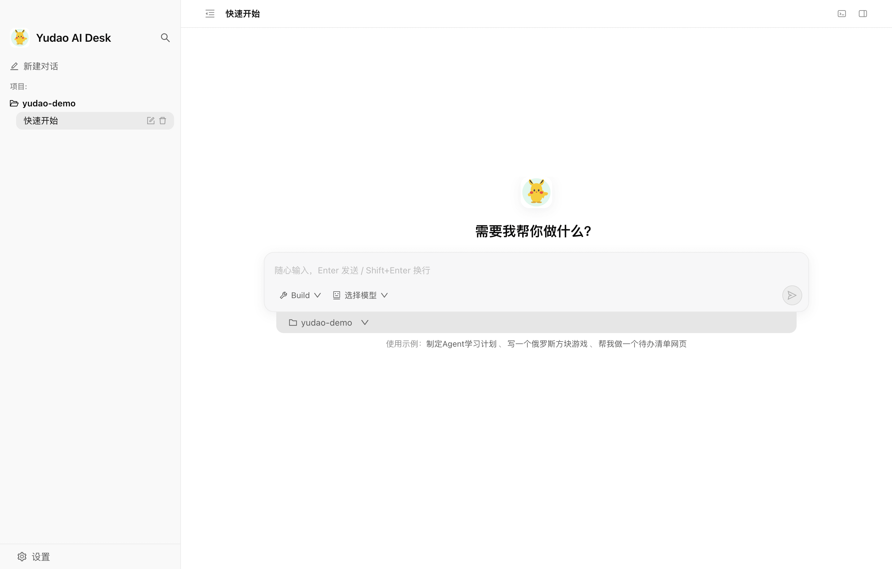
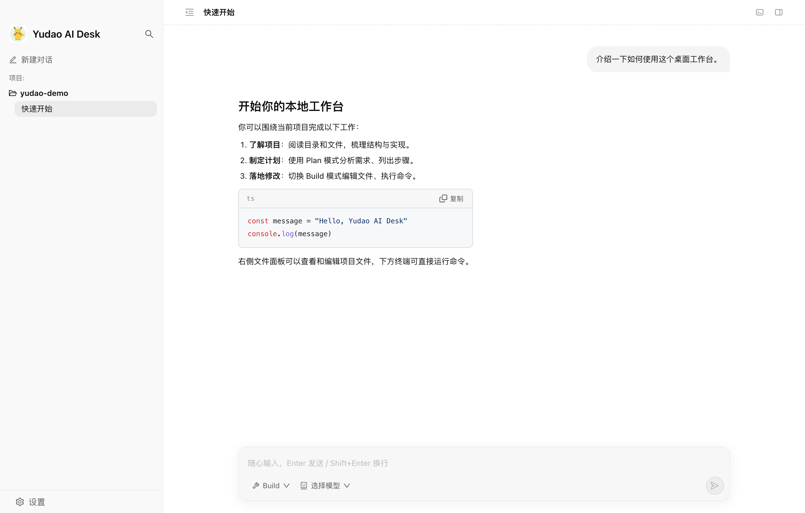
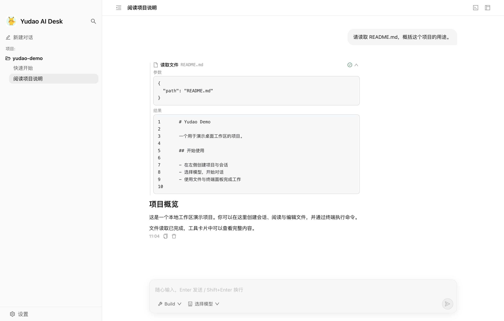
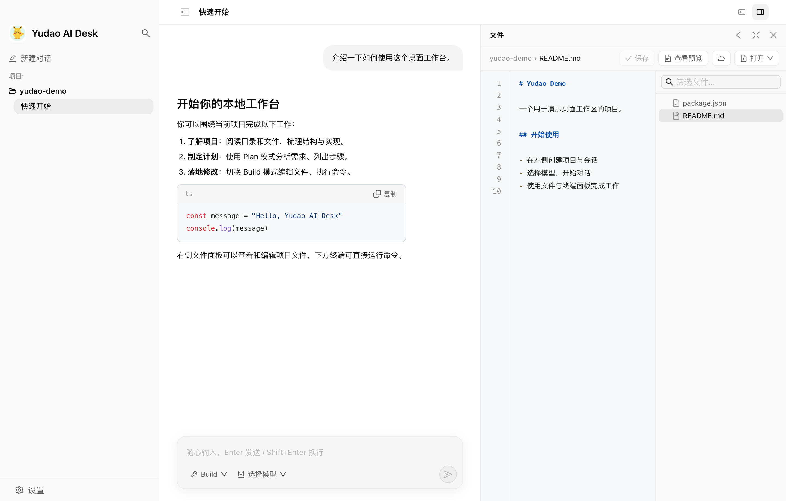
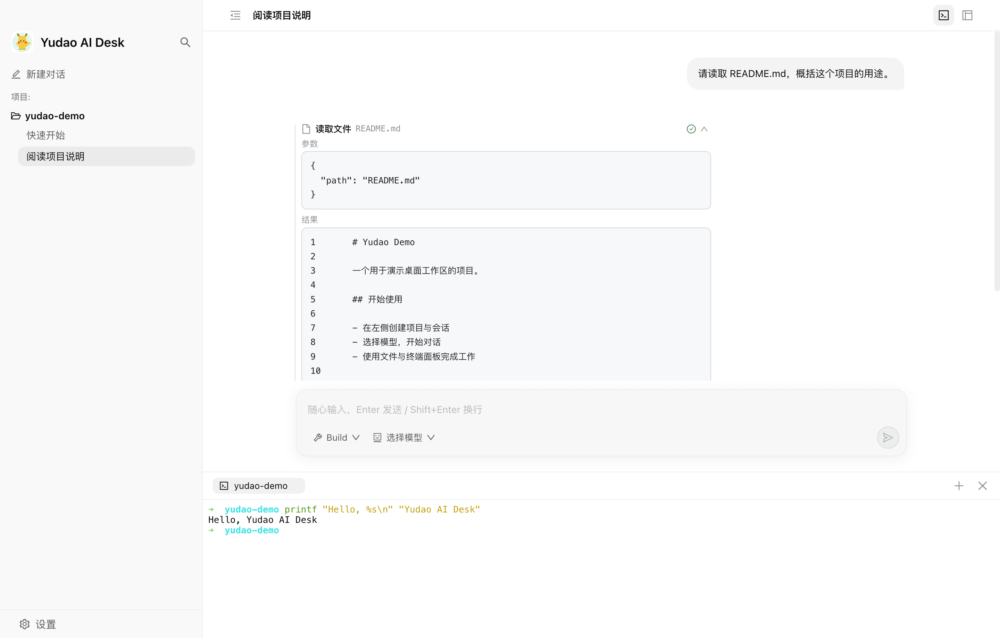
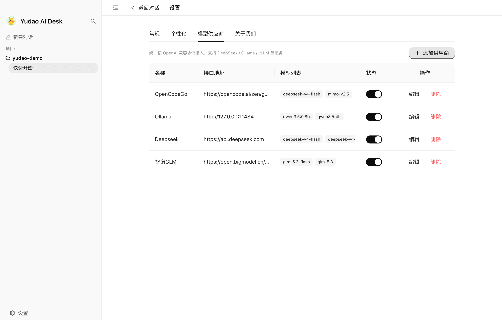
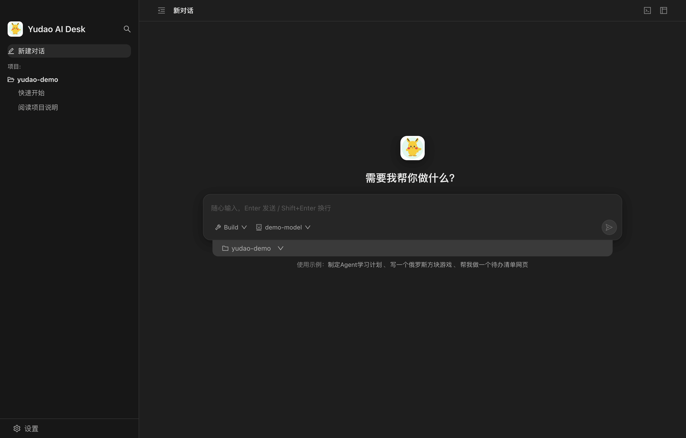

# Yudao AI Desk

Yudao AI Desk 是面向个人开发者的 AI 桌面工作台。围绕本机项目，在一个窗口中完成对话、阅读代码、编辑文件和运行命令。

项目参考自 [XXL-AI 的 Desk](https://github.com/xuxueli/xxl-ai/tree/master/xxl-ai-desk)，提供 **Vue3 + ant dv next** 和 **React + Ant Design** 两个版本。

## 两个版本

| 版本 | 技术栈 | 目录 |
| --- | --- | --- |
| Vue | Vue3、TypeScript、ant dv next、Pinia | [vue-antdv-next](./vue-antdv-next/) |
| React | React、TypeScript、Ant Design、Zustand | [react-antd](./react-antd/) |

两个版本功能一致，各自包含完整的 Electron 客户端、前端和运行环境，可以独立开发、构建和使用。根据熟悉的技术栈选择一个即可。

## 功能特性

| 功能 | 说明 |
| --- | --- |
| 项目工作区 | 将项目关联到本机目录，围绕项目创建和管理会话 |
| Plan / Build | Plan 用于阅读、搜索和分析；Build 增加文件修改和命令执行 |
| 流式对话 | 逐步显示回复，支持 Markdown、代码高亮、复制与停止生成 |
| 工具执行过程 | 按发生顺序展示思考、工具和正文，查看参数、状态、耗时与结果 |
| 文件面板 | 浏览目录、搜索文件名、编辑保存与预览内容，跟踪本地文件变化 |
| 终端面板 | 在项目目录中运行命令，支持多个终端与会话切换 |
| 浏览器面板 | 在侧边打开网页，支持多个标签页 |
| 越界访问确认 | 工具访问项目外路径时，可允许本次、允许本会话或拒绝 |
| 模型供应商 | 接入 OpenAI 兼容接口，配置服务地址、API Key、模型列表与请求头 |
| 本地存储 | 会话与消息保存在本机 SQLite，无需部署独立服务端或数据库 |
| 个性化设置 | 设置应用名称、提示语、自定义指令、快捷键和运行环境 |
| 主题与语言 | 支持浅色、深色主题及中文、英文界面 |

模型可以使用远程服务，也可以连接本机运行的 Ollama 等兼容服务；模型请求会发送到所配置的供应商。

## 产品预览

以下为两个版本的实际客户端界面，使用演示项目与示例对话。

### Vue · 工作台



### React · 工作台


### 流式对话与代码展示



### 工具执行过程



### 项目文件编辑



### 项目终端



### 模型供应商



### 深色主题



## 快速开始

环境要求：Node.js 22.12 及以上，推荐 Node.js 24。

```bash
git clone https://gitee.com/yudaocode/yudao-ai-desk.git
cd yudao-ai-desk
```

选择 Vue 版本：

```bash
cd vue-antdv-next
npm install
npm run dev
```

或从仓库根目录选择 React 版本：

```bash
cd react-antd
npm install
npm run dev
```

首次使用：

1. 打开「设置 → 模型供应商」，配置服务地址、API Key 和可用模型。
2. 创建项目，选择本机工作目录。
3. 新建会话，选择模型与 Plan / Build 模式，开始对话。
4. 根据需要打开文件、终端或浏览器面板。

## 开发与构建

在所选版本目录中执行：

| 命令 | 用途 |
| --- | --- |
| `npm run dev` | 启动开发环境 |
| `npm run type-check` | 检查 TypeScript 类型 |
| `npm run build` | 构建主进程、preload 和前端 |
| `npm run pack` | 生成本地应用目录 |
| `npm run build:mac` | 构建 macOS 安装包 |
| `npm run build:win` | 构建 Windows 安装包 |

构建产物位于各版本的 `release/` 目录。两版使用独立的应用名称和默认数据目录。

## 目录结构

```text
yudao-ai-desk/
├── vue-antdv-next/        # Vue 客户端
│   ├── src/main/          # Electron 主进程与 Agent 运行时
│   ├── src/preload/       # 主进程与界面之间的通信接口
│   ├── src/renderer/      # Vue 界面
│   └── src/shared/        # 当前版本使用的协议与类型
├── react-antd/            # React 客户端，目录职责与 Vue 版本一致
└── docs/images/           # 产品截图
```
